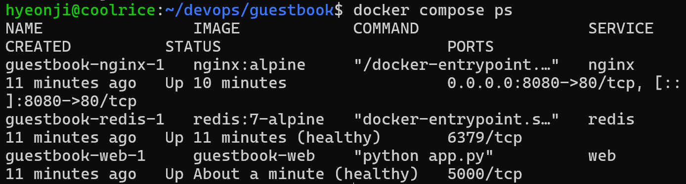
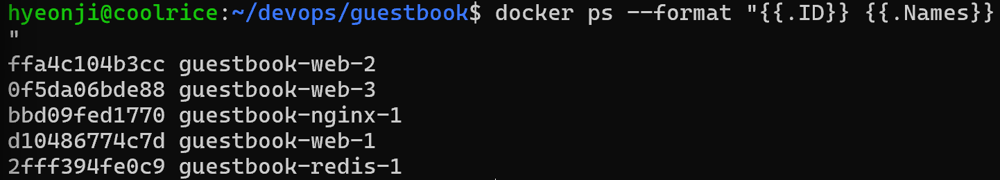

### Docker Compose

### Docker 개념 정리
1. Image
  -> 컨테이너를 생성하기 위한 실행 환경 템플릿
2. Container
  -> 이미지를 기반으로 실제 실행한 격리된 환경
3. Docker Network
  -> 서로 다른 컨테이너가 통신할 수 있도록 연결하는 가상 네트워크
4. Docker Compose
  -> 여러 컨테이너들이 함께 동작하도록 구성 및 관리하는 도구
5. Volume
  -> 컨테이너가 삭제되거나 다시 만들어져도 데이터를 유지할 수 있도록 컨테이너 외부의 저장공간과 연결하는 기능

### 앱과 DB를 하나의 컨테이너에 넣었을 경우
1. 장애 발생 시 영향 범위 커짐
  -> 컨테이너에 문제 발생 시, 앱과 DB 둘 다 영향을 미침
2. 독립적인 확장 어려움
  -> 데이터 일관성과 DB 연결 관리 복잡
3. 업데이트와 유지보수 불편
  -> 앱 코드만 변경했는데도 DB와 함께 구성된 이미지를 다시 빌드해야 하는 경우 발생
4. 보안과 접근 제어 불편
  -> 앱과 DB의 네트워크 접근 범위, 실행 권한, 환경 설정을 각각 독립적으로 제한하기 어려움

### Docker Compose 사용해야 하는 이유
- 유지보수 편의성
- 통합 관리
- 간편한 실행
- 설정 및 환경의 일관성

**.env는 비밀번호나 API 키와 같은 민감한 정보가 담겨있기 때문에 공개 저장소인 Github에 올리지 않을 것**

-----------------------

### Docker Compose 실습 결과
1. **docker compose ps 결과(healthy 포함)** 

2. **scale 후 바뀐 웹 컨테이너 호스트명** 

