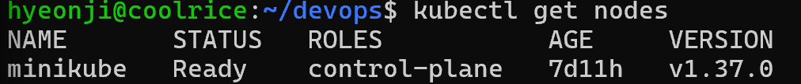
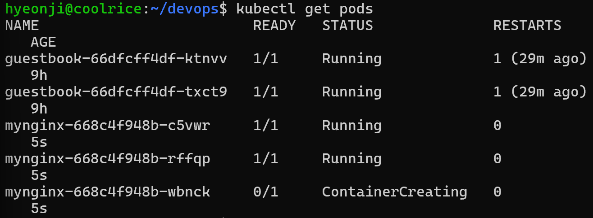
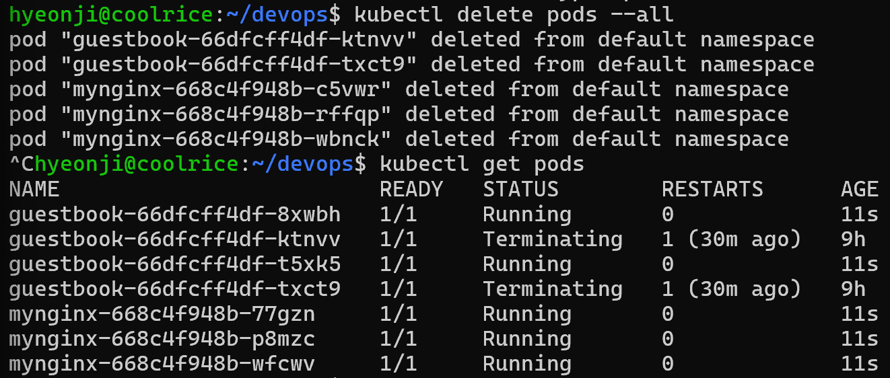

## 쿠버네티스

### Docker와 Kubernetes
1. Docker
- 컨테이너를 만드는 도구
2. Kubernetes
- 컨테이너화된 애플리케이션의 배포, 확장, 관리를 자동으로 처리해주는 오픈소스 플랫폼
- 컨테이너가 수십, 수백 개로 늘어나면 관리하기 어려워짐 -> 컨테이너 오케스트레이션 사용

### 쿠버네티스 장점
1. 자가 치유 
  -> 컨테이너가 갑자기 멈추거나 오류가 발생하면, 이를 자동으로 감지해 재시작 또는 새 컨테이너로 교체 
  -> 항상 설정한 수의 Pod를 유지하므로 서비스에 영향 X 
2. 자동 확장 
  -> 서비스에 접속자가 폭주하면 CPU나 메모리 사용량을 기반으로 컨테이너를 자동으로 늘림 
  -> 사람이 직접 서버를 추가하거나 줄일 필요 X 
3. 로드 밸런싱 
  -> 들어오는 트래픽을 여러 컨테이너(Pod)에 골고루 분배해 특정 컨테이너의 과부하를 방지 
4. 자동 롤백 
  -> 배포 중 문제가 발생하면 이전의 안정된 버전으로 자동 롤백해 서비스 중단 없이 빠르게 복구 가능 

### 클러스터
여러 서버(Node)를 하나로 묶어 쿠버네티스가 통합적으로 관리할 수 있도록 만든 환경

### kubelet
Pod 실행 및 상태 관리

### Pod
쿠버네티스에서 컨테이너를 실행하기 위한 가장 작은 배포 단위

### 네임스페이스
한 클러스터를 여러 구역을 나눠 쓰는 칸막이 역할(각 환경의 리소스 분리)

| 개념 | 비유 |
|:---:|:---:|
| 클러스터 | 회사 전체 |
| 서버(Node) | 회사의 건물 |
| kubelet | 각 건물의 관리자 |
| Pod | 건물 안의 사무실 |
| 컨테이너 | 사무실에서 실제 업무를 수행하는 직원 |

----------
## 실습

### kubectl get nodes

### Pod 지운 뒤, 새 Pod가 태어난 get pods -w 화면

