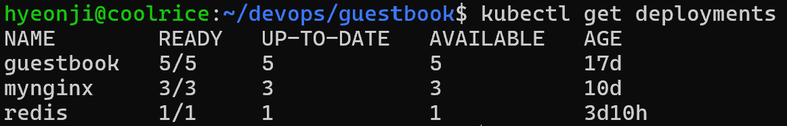
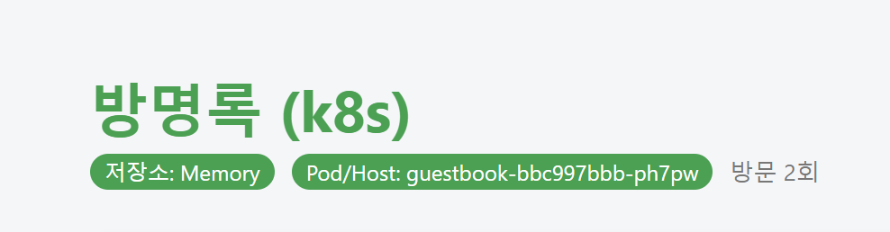
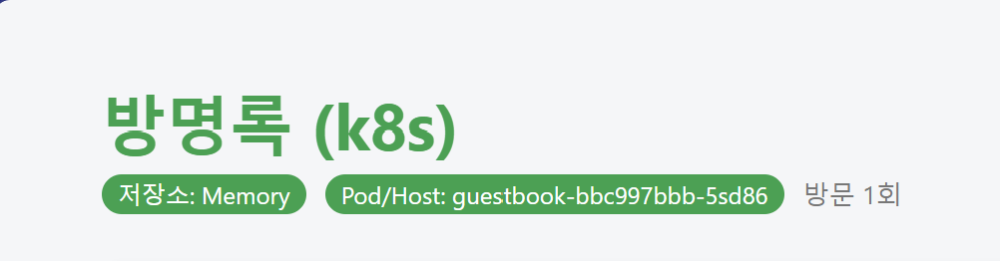
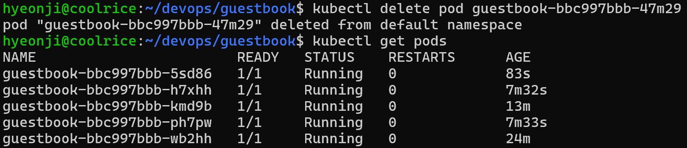
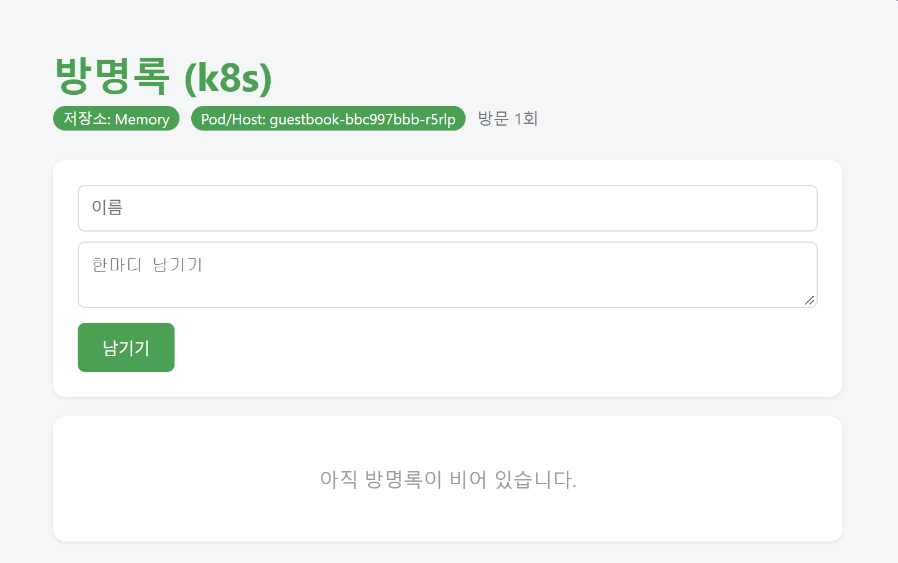
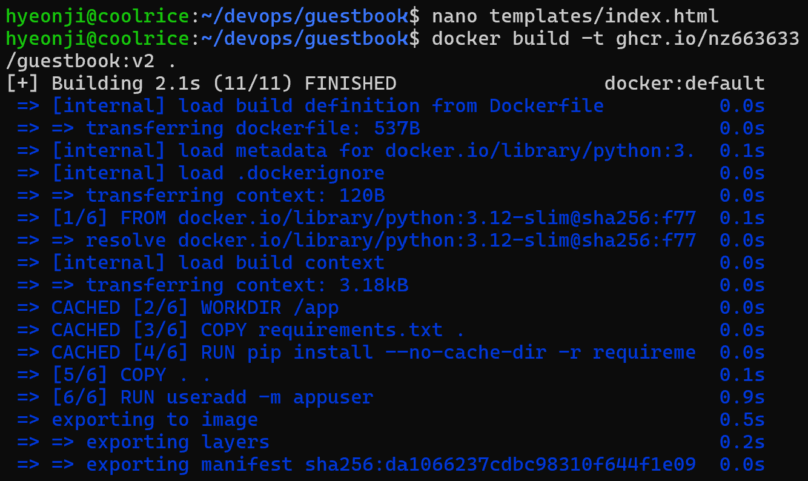
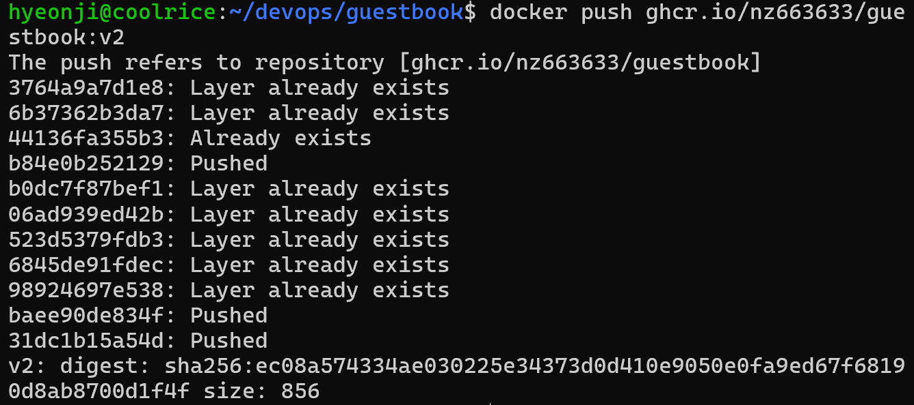
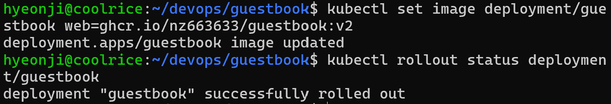
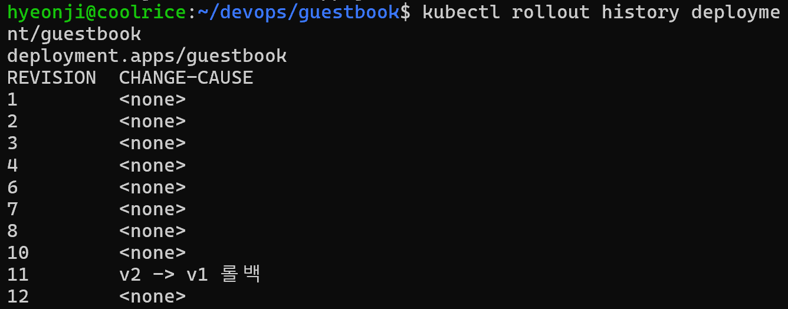
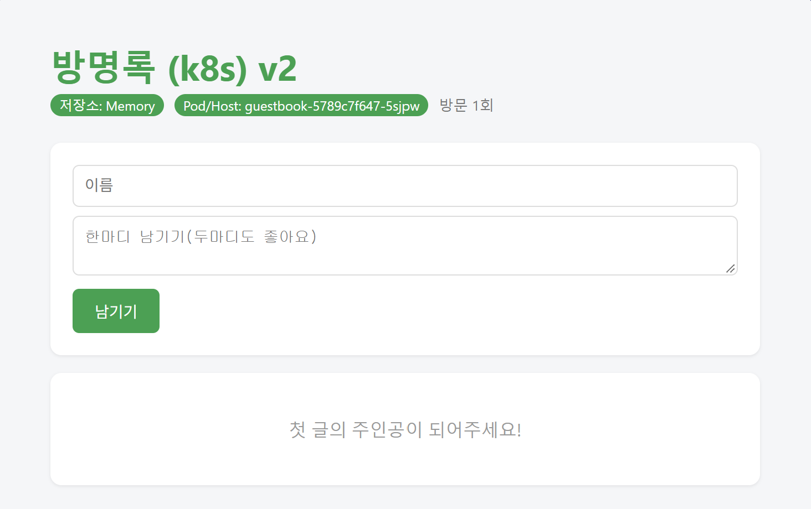

## 쿠버네티스 배포와 서비스

### 1. replicas를 5로 늘리기

 

### 2. 서로 다른 Pod hostname

 

### 3. Pod 하나 강제 삭제

 

### 4. v1 -> v2 롤링 업데이트
#### 1) guestbook:v1

 

#### 2) index.html 소스 수정
#### 3) docker 이미지 빌드

 

#### 4) ghcr에 이미지 업로드

 

#### 5) deployment 이미지 변경
#### 6) 롤링 업데이트 확인 및 롤백

 

#### 7) kubectl rollout history 결과 확인

 

#### 8) guestbook:v2

