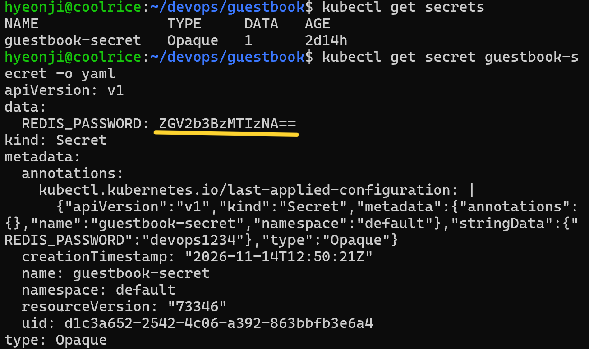
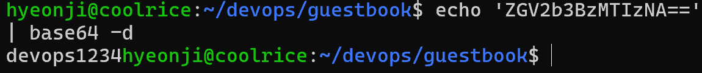
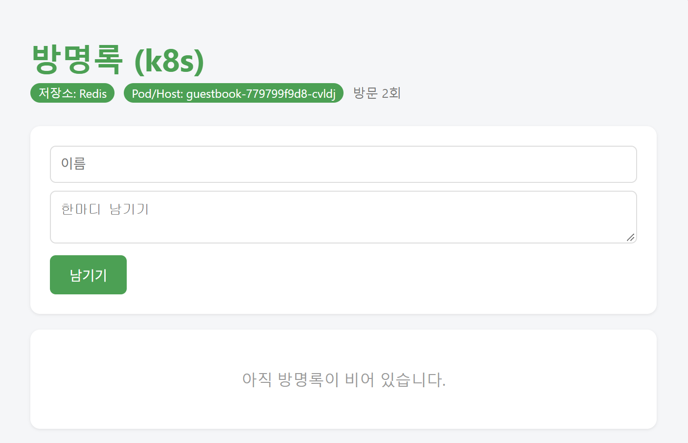
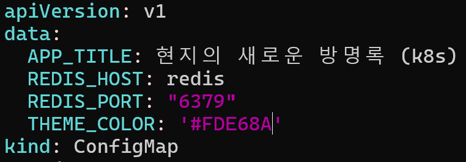
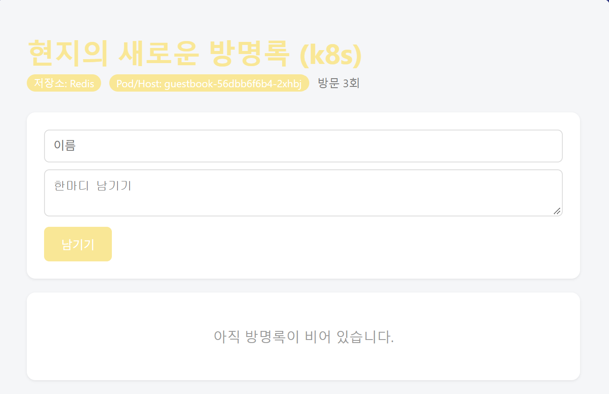

## 쿠버네티스 설정과 상태 점검

### 1. Secret을 base64 -d로 읽었을 때
-> 쿠버네티스 Secret는 데이터는 base64로 인코딩해서 저장하지만, base64는 암호화가 아니다. 
   따라서 누구나 쉽게 원래 값으로 디코딩 할 수 있기 때문에 안전하지 않다. 

#### 1) REDIS_PASSWORD 확인
 
 

#### 2) REDIS_PASSWORD 디코딩

 

### 2. ConfigMap 변경

#### 1) 기존 화면

 

#### 2) 제목과 색 변경

 

#### 3) 변경된 화면

